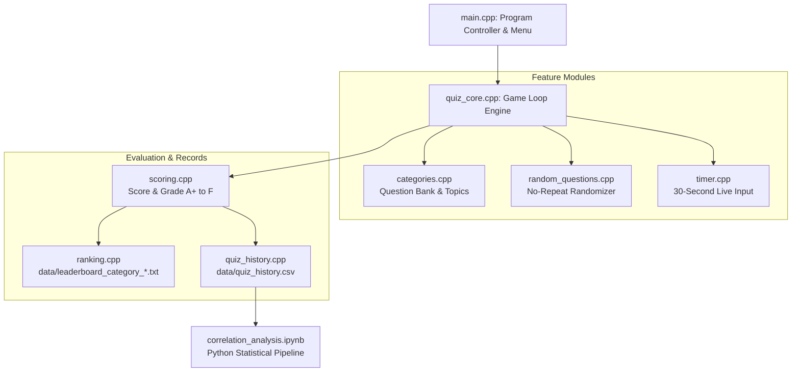

# Interactive C++ Quiz Game & Telemetry Regression Pipeline (C++ / Python)

[](https://www.donga.ac.kr/)
[](https://www.donga.ac.kr/)
[](https://en.wikipedia.org/wiki/C%2B%2B11)
[](https://www.python.org/)
[](#)

A modular, console-based multiple-choice quiz engine written in standard C++11 integrated with an empirical statistical regression and performance analysis pipeline in Python. Developed collaboratively by **Dream Team** as graduate coursework at **Dong-A University**, the application collects real-time user testing telemetry (response times, scores, percentages, and letter grades) to evaluate monotonic and linear correlations between quiz completion duration and academic performance outcomes.

> [!NOTE]
> **Academic Coursework Notice**  
> This repository contains collaborative academic coursework developed for **Portfolio Project #2 (Machine Learning & Quality Management / Industrial Applied Statistics)** in the **Department of Smart Convergence Systems Engineering at Dong-A University**, South Korea.  
> 
> *Note for academic evaluators, reviewers, and recruiters:* This project demonstrates collaborative systems software engineering, modular decomposition, and empirical data analysis in a team academic setting. It is maintained strictly as an academic record and is completely separate from my core individual research in **RISC-V ISA, computer architecture, instruction decoding, and CPU pipeline simulation in C**.

---

## Contents

- [Overview & Educational Context](#overview--educational-context)
- [Team Members & Architectural Responsibilities](#team-members--architectural-responsibilities)
- [System Architecture & Modular Design](#system-architecture--modular-design)
  - [Architectural Coordination & The Shared Header Contract (`quiz.h`)](#architectural-coordination--the-shared-header-contract-quizh)
  - [Execution Flow](#execution-flow)
- [Core Modular Components & Implementation](#core-modular-components--implementation)
- [Quality Management Extension: Telemetry & Regression Analysis](#quality-management-extension-telemetry--regression-analysis)
  - [Telemetry Dataset Schema](#telemetry-dataset-schema)
  - [Statistical Methodology & Regression Models](#statistical-methodology--regression-models)
- [Modular Project Structure](#modular-project-structure)
- [Build & Run Instructions](#build--run-instructions)
  - [Prerequisites](#prerequisites)
  - [Compilation on Windows](#compilation-on-windows)
  - [Compilation on Linux / macOS](#compilation-on-linux--macos)
- [Verification & Standalone Unit Testing](#verification--standalone-unit-testing)
- [Running the Statistical Analysis Pipeline](#running-the-statistical-analysis-pipeline)
- [Scope & Academic Context](#scope--academic-context)
- [Authors & Academic Attribution](#authors--academic-attribution)

---

## Overview & Educational Context

Modern software engineering and Quality Management (QM) rely on observable metrics and statistical verification. This project transforms standard command-line quiz software into an instrumented, data-gathering educational tool:

- **Modular Software Engineering**: Clean separation of concerns across multiple C++ translation units communicating strictly through a unified header interface contract (`quiz.h`).
- **Interactive Console UX**: A responsive, 30-second live non-blocking countdown timer implemented with Windows console APIs alongside portable POSIX fallback routines.
- **Empirical Telemetry Collection**: Automated recording of session timestamps, categories, accuracy rates, and execution elapsed times to persistent CSV files.
- **Statistical Quality Analysis**: Ingesting operational session telemetry into Python (Jupyter / Google Colab) to conduct Spearman's rank correlation and Ordinary Least Squares (OLS) linear regression.

---

## Team Members & Architectural Responsibilities

Developed by **Dream Team**, Department of Smart Convergence Systems Engineering, Dong-A University:

| Member | Student ID | Academic Status | Core Responsibilities & Modules |
| :--- | :---: | :--- | :--- |
| **Dharanidharan Ravikumar** ([@DharanidharanRavikumar](https://github.com/DharanidharanRavikumar)) | 2671007 | Master's Student | **System Architecture & Integration**, Main Game Flow (`main.cpp`, `quiz_core.cpp`), Shared Header Interface Definition (`quiz.h`), Category-Specific Leaderboard Ranking System (`ranking.cpp`) |
| **Maria Liezel Eusebio** ([@mceusebio](https://github.com/mceusebio)) | 2677319 | Master's Student | **Categories & Question Bank** (`categories.cpp`), Statistical Correlation & Regression Pipeline (`correlation_analysis.ipynb`) |
| **Saranrat Roteaim** ([@SaranratR](https://github.com/SaranratR)) | 2677934 | Master's - PhD Integrated | **Random Question Generator** without replacement (`random_questions.cpp`) |
| **Patthadol Raksapram** ([@Dolptd](https://github.com/Dolptd)) | 2677946 | Master's - PhD Integrated | **30-Second Timed Answer Input** (`timer.cpp`), Session Telemetry CSV Logger (`quiz_history.cpp`) |
| **Manaswin Perarattananon** ([@paan202426](https://github.com/paan202426)) | 2674594 | PhD Student | **Scoring Algorithms**, Percentage Calculation, Letter Grade Assignment (A+ to F) & Summary Display (`scoring.cpp`) |

---

## System Architecture & Modular Design



### Architectural Coordination & The Shared Header Contract (`quiz.h`)

To enable five developers to work concurrently without merge conflicts or interface divergence, the system architecture enforces an explicit boundary contract defined in `quiz.h`:

```cpp
// ---------- Shared settings ----------
const int QUESTIONS_PER_QUIZ   = 10;  // Number of questions per quiz session
const int SECONDS_PER_QUESTION = 30;  // Per-question countdown time limit

// ---------- Module Interface Contract ----------
// categories.cpp (Maria Liezel Eusebio)
int getNumberOfCategories();
string getCategoryName(int category);
int getQuestionCount(int category);
string getQuestionText(int category, int questionNumber);
string getChoice(int category, int questionNumber, int choiceNumber);
char getCorrectAnswer(int category, int questionNumber);

// random_questions.cpp (Saranrat Roteaim)
void pickRandomQuestions(int totalQuestions, int howManyToPick);
int getPickedQuestion(int position);

// timer.cpp (Patthadol Raksapram)
char getTimedAnswer(int seconds);

// scoring.cpp (Manaswin Perarattananon)
int calculatePercent(int correctAnswers, int totalQuestions);
string calculateGrade(int percent);
void showResultSummary(string username, int correctAnswers, int totalQuestions,
                       int percent, string grade);

// quiz_core.cpp & ranking.cpp (Dharanidharan Ravikumar)
int runQuiz(int category, int numberOfQuestions);
void saveAndShowRanking(string username, int percent, int category);

// quiz_history.cpp (Telemetry Logger)
bool saveQuizHistory(const string& username, int category, int correctAnswers,
                     int totalQuestions, int percent, const string& grade,
                     double durationSeconds);
```

### Execution Flow
1. **User Registration & Category Selection**: User enters a username and chooses between Category 1 (C Programming & Fundamentals) and Category 2 (HTML & Web Development Concepts).
2. **Deterministic Random Sampling**: 10 distinct, non-repeating question indices are selected from the 20-question bank.
3. **Interactive Timed Loop**: Displays question text and 4 choices with a real-time countdown timer. Validates responses (`A`, `B`, `C`, `D`). Unanswered timeouts or invalid inputs are treated as incorrect.
4. **Scoring & Letter Grade Resolution**: Percentage is computed and mapped to an academic grade (`A+` to `F`).
5. **Leaderboard & Telemetry Logging**: Updates local top-score records and appends the session execution record to `data/quiz_history.csv`.
6. **Statistical Analysis**: The CSV log is ingested into `correlation_analysis.ipynb` for Spearman correlation testing and regression modeling.

---

## Core Modular Components & Implementation

| Source Module | Primary Functions | Implementation Details |
| :--- | :--- | :--- |
| `main.cpp` | `main()` | Application lifecycle controller, user authentication prompt, category selection menu, and replay loop. |
| `quiz_core.cpp` | `runQuiz()` | Manages question traversal, interacts with timer, queries answer keys, and accumulates score. |
| `categories.cpp` | `getQuestionText()`, `getChoice()`, etc. | In-memory database of 40 multi-discipline questions (C syntax, pointers, data types, HTML tags, CSS styling). |
| `random_questions.cpp` | `pickRandomQuestions()`, `getPickedQuestion()` | Fisher-Yates-inspired unique index generator ensuring no duplicate questions appear in a single run. |
| `timer.cpp` | `getTimedAnswer()` | Non-blocking console polling using `_kbhit()` and `_getch()` on Windows (`conio.h`) with POSIX newline fallback. |
| `scoring.cpp` | `calculatePercent()`, `calculateGrade()` | Standardized grading bounds: `95%+ → A+`, `90%+ → A`, `80%+ → B`, `70%+ → C`, `60%+ → D`, `<60% → F`. |
| `ranking.cpp` | `saveAndShowRanking()` | File I/O leaderboard manager sorting and persisting top 5 scores per category. |
| `quiz_history.cpp` | `saveQuizHistory()` | Comma-Separated Values (CSV) serializer recording timestamp, duration to 3 decimal places, and outcome metrics. |

---

## Quality Management Extension: Telemetry & Regression Analysis

The Quality Management (QM) extension applies industrial applied statistics to verify how cognitive speed influences test accuracy.

### Telemetry Dataset Schema

Telemetry records are appended to `quiz_game/data/quiz_history.csv`:

```text
timestamp,username,category,correct_answers,total_questions,percentage,grade,duration_seconds
2026-11-21 10:15:32,Dharani,1,10,10,100,A+,142.315
2026-11-21 10:22:04,Student_2,2,8,10,80,B,215.820
```

### Statistical Methodology & Regression Models

- **Independent Variable (X)**: Quiz Completion Duration (recorded in seconds).
- **Dependent Variable (Y)**: Final Percentage Score (0% to 100%) and Letter Grade Rank (F < D < C < B < A < A+).
- **Spearman's Rank Correlation (ρ)**:
  ```text
  ρ = 1 - (6 × Σ dᵢ²) / (n(n² - 1))
  ```
  Assesses monotonic relationships between response time and academic performance without assuming normality.
- **Hypothesis Testing**: Permutation testing against a significance threshold of alpha = 0.05.
- **Ordinary Least Squares (OLS) Linear Regression**:
  ```text
  Predicted Score (%) = β₀ + β₁ × Duration (seconds)
  ```
  Evaluates trend direction and slope sensitivity for Category 1 vs Category 2.

---

## Modular Project Structure

```text
├── Portfolio Project #2.pdf          # Academic presentation slide deck (PDF format)
├── Portfolio Project #2.pptx         # Academic presentation slide deck (PowerPoint format)
├── correlation_analysis.ipynb        # Jupyter notebook for Spearman correlation & OLS regression
├── EMAIL_PACKAGE_NOTES.txt           # Academic submission distribution notes
├── .gitignore                        # Excludes build binaries (*.exe, *.o) and runtime leaderboards
├── README.md                         # Project documentation
└── quiz_game/                        # C++ core source tree
    ├── main.cpp                      # Program entry point and menu flow
    ├── quiz.h                        # Master architectural header and interface contract
    ├── quiz_core.cpp                 # Quiz execution engine
    ├── categories.cpp                # Category and question database
    ├── random_questions.cpp          # Non-repeating randomized question selector
    ├── timer.cpp                     # 30-second live countdown timer (Windows & POSIX)
    ├── scoring.cpp                   # Grading scales, percentages, and summaries
    ├── ranking.cpp                   # Category-specific leaderboard management
    ├── quiz_history.cpp              # CSV telemetry export
    ├── build.sh                      # Shell build script for Linux / macOS
    ├── README.md                     # Component documentation
    ├── data/                         # Persistent logs
    │   ├── .gitkeep
    │   └── quiz_history.csv          # Telemetry session dataset
    └── tests/                        # Standalone unit test drivers
        ├── test_categories.cpp
        ├── test_random.cpp
        ├── test_scoring.cpp
        └── test_timer.cpp
```

---

## Build & Run Instructions

### Prerequisites
- Standard C++11 compiler (`g++` or `clang++`).
- Python 3.8+ with `pandas`, `numpy`, `scipy`, `matplotlib` (for telemetry regression analysis).

### Compilation on Windows

Using PowerShell or Command Prompt with GCC / MinGW-w64:

```powershell
cd quiz_game
mkdir data -ErrorAction SilentlyContinue
g++ -Wall -std=c++11 main.cpp quiz_core.cpp ranking.cpp categories.cpp random_questions.cpp timer.cpp scoring.cpp quiz_history.cpp -o quiz.exe
.\quiz.exe
```

### Compilation on Linux / macOS

```bash
cd quiz_game
mkdir -p data
chmod +x build.sh
./build.sh
```

---

## Verification & Standalone Unit Testing

Individual modules can be tested in isolation using the test harnesses provided in `quiz_game/tests/`:

```powershell
# 1. Test question retrieval and database integrity
g++ -Wall -std=c++11 tests/test_categories.cpp categories.cpp -o test_categories.exe
.\test_categories.exe

# 2. Test randomized sampling and non-repetition
g++ -Wall -std=c++11 tests/test_random.cpp random_questions.cpp -o test_random.exe
.\test_random.exe

# 3. Test grade mapping and percentage calculations
g++ -Wall -std=c++11 tests/test_scoring.cpp scoring.cpp -o test_scoring.exe
.\test_scoring.exe

# 4. Interactive countdown timer verification
g++ -Wall -std=c++11 tests/test_timer.cpp timer.cpp -o test_timer.exe
.\test_timer.exe
```

---

## Running the Statistical Analysis Pipeline

1. Open [`correlation_analysis.ipynb`](correlation_analysis.ipynb) in Jupyter Notebook, VS Code, or Google Colab.
2. Ingest `quiz_game/data/quiz_history.csv` when prompted.
3. Run all cells to compute sample sizes, rank coefficients, p-values, descriptive regression lines, and generate categorized scatter plots.

---

## Scope & Academic Context

This repository is maintained as a record of graduate academic coursework:
1. **Coursework Context**: Developed for Portfolio Project #2 (ML & QM) under the Department of Smart Convergence Systems Engineering at Dong-A University.
2. **Team Collaboration**: Highlights modular interface coordination, source integration, and shared architectural contracts.
3. **Domain Independence**: Distinct from my specialized research domain in **computer architecture, CPU pipeline simulation in C, and RISC-V ISA instruction decoding**.

---

## Authors & Academic Attribution

- **Dharanidharan Ravikumar** — Graduate Student, Dong-A University ([@DharanidharanRavikumar](https://github.com/DharanidharanRavikumar))
- **Maria Liezel Eusebio** — Graduate Student, Dong-A University ([@mceusebio](https://github.com/mceusebio))
- **Saranrat Roteaim** — Integrated Graduate Student, Dong-A University ([@SaranratR](https://github.com/SaranratR))
- **Patthadol Raksapram** — Integrated Graduate Student, Dong-A University ([@Dolptd](https://github.com/Dolptd))
- **Manaswin Perarattananon** — PhD Student, Dong-A University ([@paan202426](https://github.com/paan202426))
