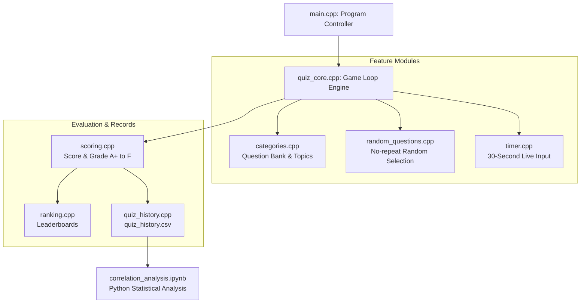

# Interactive C++ Quiz Game: Performance Data Collection & Linear Regression Analysis

[](https://www.donga.ac.kr/)
[](https://www.donga.ac.kr/)
[](quiz_game/)
[](correlation_analysis.ipynb)
[](#team-members--responsibilities)

> [!NOTE]
> **Academic Coursework Notice**  
> This repository contains collaborative academic coursework developed for **Portfolio Project #2 (Machine Learning & Quality Management / Industrial Applied Statistics)** in the **Department of Smart Convergence Systems Engineering at Dong-A University**, South Korea.  
> 
> *Note for academic evaluators, reviewers, and recruiters:* This repository demonstrates collaborative software engineering, modular system design, and empirical data analysis in a team academic environment. It is maintained strictly as an academic record and is distinct from primary individual research tracks in **RISC-V processor architecture, hardware description languages (Verilog), and instruction set design**.

---

## 📌 Executive Summary

This project integrates a **modular console-based Quiz Game written in C++11** with an **empirical statistical regression pipeline in Python**. The software presents timed multiple-choice questions, computes grades, maintains persistent high scores, and logs detailed session metrics (timestamps, durations, categories, percentages, and letter grades) to a CSV dataset. 

The collected telemetry data is subsequently processed using **Spearman's rank correlation and Ordinary Least Squares (OLS) regression** in Python to analyze the relationship between quiz response duration and academic performance outcomes.

```
┌────────────────────────────────────────────────────────┐
│               Interactive C++ Quiz Game                │
│  Modular Engine · Countdown Timer · Question Bank      │
│  Leaderboard Persistence · CSV Telemetry Logging       │
└──────────────────────────┬─────────────────────────────┘
                           │ Outputs: quiz_history.csv
                           ▼
┌────────────────────────────────────────────────────────┐
│              Statistical Analysis Pipeline              │
│  Jupyter Notebook · Spearman's Rank Correlation        │
│  OLS Linear Regression · Scatter & Fitted Plots        │
└────────────────────────────────────────────────────────┘
```

---

## 👥 Team Members & Responsibilities

Developed by **Dream Team**, Department of Smart Convergence Systems Engineering, Dong-A University:

| Member | Student ID | Academic Status | Core Responsibilities & Modules |
| :--- | :---: | :--- | :--- |
| **Dharanidharan Ravikumar** | 2671007 | Master's Student | **System Architecture & Integration**, Main Game Flow (`main.cpp`, `quiz_core.cpp`), Category-Specific Leaderboard Ranking System (`ranking.cpp`) |
| **Maria Liezel Eusebio** | 2677319 | Master's Student | **Categories & Question Bank** (`categories.cpp`), Statistical Correlation & Regression Pipeline (`correlation_analysis.ipynb`) |
| **Saranrat Roteaim (Fah)** | 2677934 | Master's - PhD Integrated | **Random Question Generator** without replacement (`random_questions.cpp`) |
| **Patthadol Raksapram (Pawe)** | 2677946 | Master's - PhD Integrated | **30-Second Timed Answer Input** (`timer.cpp`), Session Telemetry CSV Logger (`quiz_history.cpp`) |
| **Manaswin Perarattananon (Paan)** | 2674594 | PhD Student | **Scoring Algorithms**, Percentage Calculation, Letter Grade Assignment (A+ to F) & Summary Display (`scoring.cpp`) |

---

## 🏗️ System Architecture & Workflow

The C++ application is designed around modular decomposition where feature components communicate via a unified header interface (`quiz.h`):



### Execution Flow:
1. **Registration & Category Selection**: User registers a handle and selects either **Category 1 (C Programming & Fundamentals)** or **Category 2 (HTML & Web Development)**.
2. **Randomized Selection**: 10 distinct questions are drawn at random without replacement.
3. **Timed Question Loop**: Each question displays 4 multiple-choice options with an active 30-second countdown timer. Correct answers award 1 point; timeouts and incorrect answers award 0.
4. **Scoring & Evaluation**: The engine computes total score, percentage, and assigns an academic letter grade (`A+`, `A`, `B+`, `B`, `C+`, `C`, `D+`, `D`, `F`).
5. **Persistence**:
   - Updates local category leaderboard (`data/leaderboard_category_<id>.txt`).
   - Appends full session record to `data/quiz_history.csv`.
6. **Data Analysis**: `correlation_analysis.ipynb` ingests the CSV telemetry to model completion duration versus score outcomes.

---

## 📊 Statistical Analysis (QM Extension)

The project extends standard programming exercises into **Quality Management (QM) & Applied Statistics**:

- **Independent Variable ($X$)**: Quiz Completion Duration (seconds).
- **Dependent Variable ($Y$)**: Grade Rank / Score Percentage ($0 - 100\%$).
- **Methodology**:
  - **Spearman's Rank Correlation ($\rho$)**: Evaluates monotonic association between response time and achieved grades across categories.
  - **Permutation Testing**: Assesses statistical significance against an $\alpha = 0.05$ threshold.
  - **Ordinary Least Squares (OLS)**: Fits descriptive linear trendlines to visualize time-performance trade-offs.

---

## 📂 Repository Structure

```text
├── Portfolio Project #2.pdf          # Academic presentation slide deck (PDF format)
├── Portfolio Project #2.pptx         # Academic presentation slide deck (PowerPoint format)
├── correlation_analysis.ipynb        # Statistical correlation & regression notebook
├── EMAIL_PACKAGE_NOTES.txt           # Academic packaging notes
├── README.md                         # Project documentation
├── .gitignore                        # Git exclusion rules
└── quiz_game/                        # C++ source code directory
    ├── main.cpp                      # Program entry point & menu flow
    ├── quiz.h                        # Central definitions and module declarations
    ├── quiz_core.cpp                 # Question presentation and answer verification
    ├── categories.cpp                # Category definitions and question database
    ├── random_questions.cpp          # Non-repeating question randomization
    ├── timer.cpp                     # 30-second live countdown timer (Windows/POSIX)
    ├── scoring.cpp                   # Grading scales, percentages, and summaries
    ├── ranking.cpp                   # Category-specific leaderboard management
    ├── quiz_history.cpp              # CSV telemetry export
    ├── build.sh                      # Shell build script for Linux / macOS
    ├── README.md                     # C++ component documentation
    ├── data/                         # Telemetry logs and leaderboards
    │   ├── .gitkeep
    │   └── quiz_history.csv          # Sample/collected session telemetry
    └── tests/                        # Standalone component test suites
        ├── test_categories.cpp
        ├── test_random.cpp
        ├── test_scoring.cpp
        └── test_timer.cpp
```

---

## 🛠️ Build & Installation

### Prerequisites
- **C++ Compiler**: GCC (`g++`) or Clang supporting **C++11** or newer.
- **Python Environment**: Python 3.8+ with `pandas`, `numpy`, `scipy`, `matplotlib` (or Google Colab) for statistical analysis.

### Building the C++ Quiz Game

#### On Windows (PowerShell / Command Prompt):
```powershell
cd quiz_game
mkdir data -ErrorAction SilentlyContinue
g++ -Wall -std=c++11 main.cpp quiz_core.cpp ranking.cpp categories.cpp random_questions.cpp timer.cpp scoring.cpp quiz_history.cpp -o quiz.exe
.\quiz.exe
```

#### On Linux / macOS:
```bash
cd quiz_game
mkdir -p data
chmod +x build.sh
./build.sh
```

### Running Component Unit Tests

Independent verification drivers are provided inside `quiz_game/tests/`:

```powershell
# Compile and run individual module test drivers
g++ -Wall -std=c++11 tests/test_categories.cpp categories.cpp -o test_categories.exe
.\test_categories.exe

g++ -Wall -std=c++11 tests/test_random.cpp random_questions.cpp -o test_random.exe
.\test_random.exe

g++ -Wall -std=c++11 tests/test_scoring.cpp scoring.cpp -o test_scoring.exe
.\test_scoring.exe

g++ -Wall -std=c++11 tests/test_timer.cpp timer.cpp -o test_timer.exe
.\test_timer.exe
```

---

## 📈 Running the Statistical Analysis

1. Launch Jupyter Notebook or upload [`correlation_analysis.ipynb`](correlation_analysis.ipynb) to Google Colab.
2. Ingest `quiz_game/data/quiz_history.csv` when prompted.
3. Execute the cells to produce category-segmented Spearman correlation statistics, significance p-values, and scatter regression plots.

---

## 📄 License & Attribution

This project is submitted in partial fulfillment of coursework requirements for **Portfolio Project #2: ML & QM** at **Dong-A University**. All original intellectual contributions are credited to the Dream Team authors listed above.
